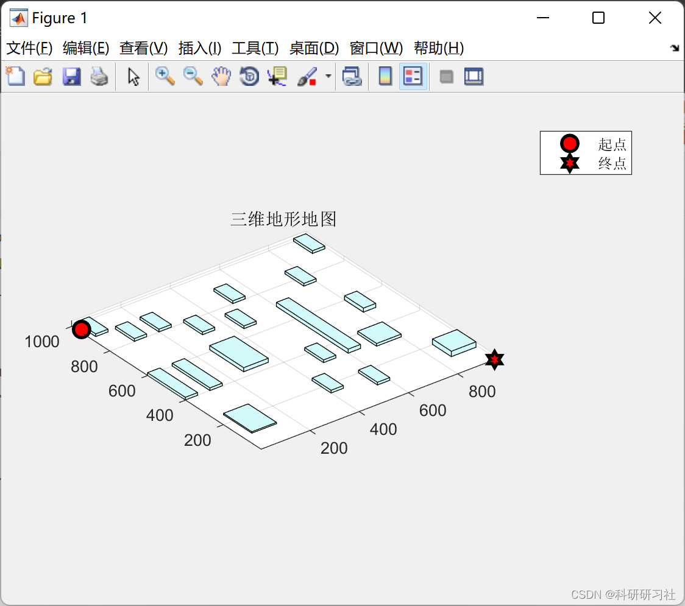
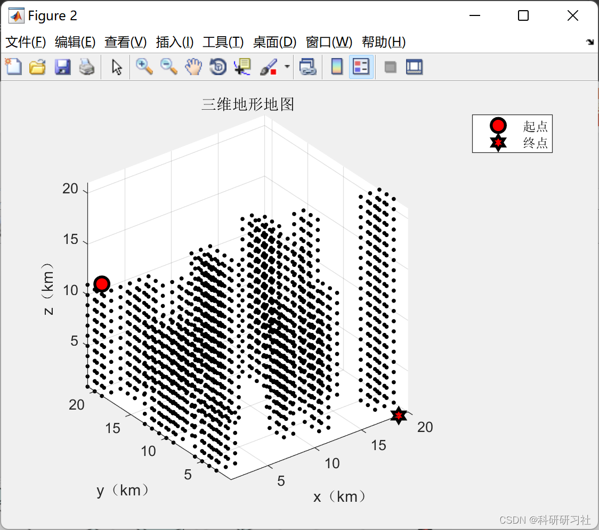

# Drone Path Planning Based on Intelligent Optimization Algorithm (Matlab Code Implementation)

​  
Imperial Penguin Optimization Algorithm for Solving.
1. Overview of drones as a modern aviation equipment. Not only does it have a fast processing speed, Low cost. It also possesses excellent flexibility and timeliness. Often used to complete those tedious, Dangerous High flexibility requirements. Tasks with a broad scope of work. For example, aerial photography. Pesticide spraying Customs inspection Power testing In the fields of flood prevention and drought resistance, with the advancement of technology. Combine the unique advantages of drones with different industry technologies. Can be applied to different industries. For example, Drones equipped with imaging sensors. A new type of surveillance device capable of capturing target images can be formed. Currently, Many countries are actively expanding the technology of drones combined with industrial applications. Therefore, the research of drone applications has always been highly regarded.
2. The Matlab code implementation of this article is only a part of the code, and all the code can be found by clicking the link:
Drone Path Planning Based on Empire Penguin Optimization Algorithm (Matlab Code Implementation)
function [fit,result,x0]=aimFcn_1(x,option,data)\nx0=x;\n%% \nx=reshape(x,data.mapSize0);\n%%\n\nS=data.S0;\nE=data.E0;\nflag=x*0;\npath=S;\nmap=data.map;\nwhile sum(S==E)~=3\n    % movable point\n    nextN=repmat(S,length(data.direction(:,1)),1)+data.direction;\n    % Remove out-of-bound points\n    flag=nextN(:,1)*0;\n    for i=1:length(nextN(:,1))\n        for j=1:3\n            if nextN(i,j)<=0 ||nextN(i,j)>data.mapSize0(j)\n                flag(i)=1;\n            end\n        end\n    end\n    position=find(flag==1);\n    nextN(position,:)=[];\n    % Remove immovable points\n    flag=nextN(:,1)*0;\n    for i=1:length(nextN(:,1))\n        no1=nextN(i,1);\n        no2=nextN(i,2);\n        no3=nextN(i,3);\n        if map(no1,no2,no3)==1\n            flag(i)=1;\n        end\n    end\n    position=find(flag==1);\n    nextN(position,:)=[];\n    if isempty(nextN)\n        S=path(end-1,:);\n        path(end,:)=[];\n        continue;\n    end\n    %\n    D1=nextN(:,1)*0;\n    D2=nextN(:,1)*0;\n    pri=nextN(:,1)*0;\n    for i=1:length(nextN(:,1))\n        no1=nextN(i,1);\n        no2=nextN(i,2);\n        no3=nextN(i,3);\n        D1(i)=norm(nextN(i,:)-S);\n        D2(i)=norm(nextN(i,:)-E);\n        pri(i)=x(no1,no2,no3);\n    end\n    [~,no]=min((D1+D2).*pri.^0.5);\n    path=[path;nextN(no,:)];\n    S=nextN(no,:);\n    map(S(1),S(2),S(3))=1;\nend\nD=0;\nfor i=1:length(path(:,1))-1\n    D=D+norm(path(i,:)-path(i+1,:));\nend\nfit=D;\nif nargout>1\n    result.fit=fit;    % Total Objective\n    result.path=path;\nend\nend\n  
3. Running Results Editing
Editor
4. References [1] Ma Huawei, Ma Kai, Guo Jun. Research on vehicle path planning with drones considering multiple delivery[J]. Computer Engineering, 2022, 48(8):299-305
[2] Chen Yaqing, Zheng Xiyuan, Han Dan, Liu Cheng. Research on the Development Status and Path Planning of Civil UAVs [J]. Science and Technology with Engineering, 2022, 22(15): 5951-5966
5. Conclusion
​  

## Images

<!-- PAYMENT_BLOCK -->

## Get this dataset

- Payment link (Stripe): [Buy now](https://buy.stripe.com/3cs8yP7sY87d0vu9AB)
- Payment QR code: 

<!-- /PAYMENT_BLOCK -->
